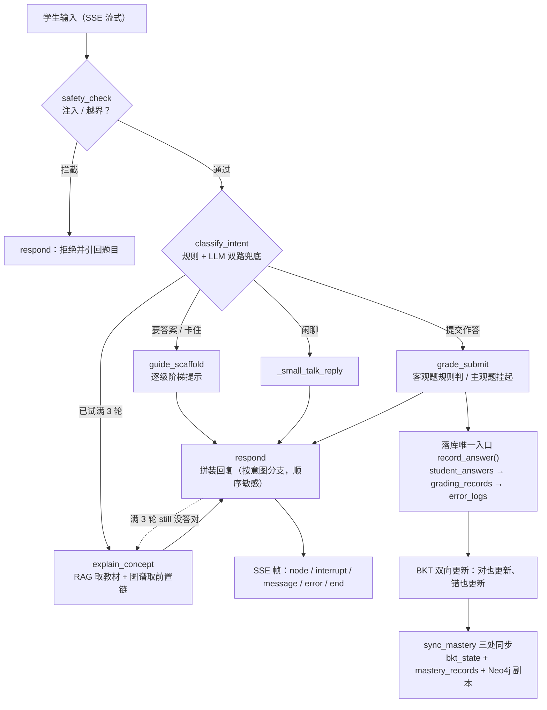
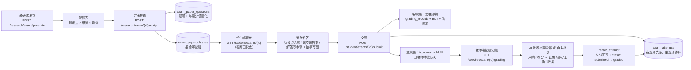
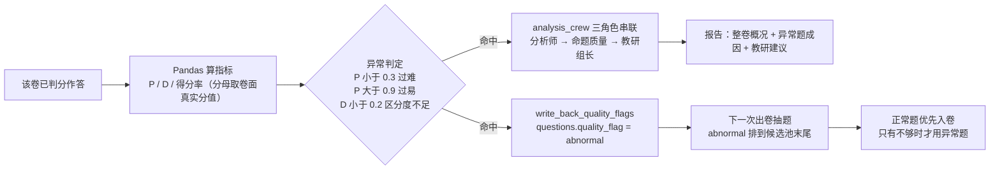

# HHT棱镜课堂 / PrismEdu

以 **BKT 掌握度为状态中枢**的三端学情闭环 Agent 系统（学生端 / 老师端 / 教研端 + 管理后台）。

一句话定位：学生求答案不给答案给引导、主观题 AI 建议老师拍板、考后分析自动回流考前命题——
三条闭环线把「学 → 练 → 考 → 析 → 补」串成一个可演示、可复现的环。

| 项 | 内容 |
|---|---|
| 技术栈 | FastAPI + LangGraph（3 张图）+ CrewAI（2 套 crew）+ SQLAlchemy/Alembic |
| 前端 | `web_app/`：原生 ES Modules + Hash 路由，**零构建、零 npm**（14 个文件，四端 SPA） |
| 数据面 | PostgreSQL **23 张表**（含 PostgresSaver 快照）+ Neo4j 知识图谱 + Milvus 双 collection（题库/教材）+ Redis（登录失败计数） |
| 规模 | 后端 52 个端点 · 测试 569 条（其中越权矩阵 353 条） |
| 配套文档 | `docs/01_PRD`（做什么）、`docs/02_技术架构`（怎么做）、`docs/03_开发计划`（顺序与判据）、`docs/04_设计决策`（为什么）、`docs/05_问题定位案例`（踩过的坑） |

---

## 一、核心流程图

### 1.1 系统全景：四端 → 一个 API → 三种智能 → 三份数据

```mermaid
flowchart LR
    subgraph FE["前端 web_app · 原生 ES Modules · :5173"]
        S["学生端<br/>概览 / 考试 / 掌握度 / 学习助手 / 诊断测验"]
        T["老师端<br/>待批改 / 布置作业 / 班级学情"]
        RS["教研端<br/>年级学情 / 班级对比 / 智能出卷 / 考后分析"]
        AD["管理后台<br/>导入 / 用户 / 授课 / 任命 / 班级 / 日志"]
    end

    FE -->|"HTTP REST + SSE<br/>JWT + 双通道 scope（detail / aggregate）"| API["FastAPI · :8100<br/>/api/{student,teacher,research,admin}"]

    subgraph AG["智能层"]
        G1["LangGraph · 学生引导图<br/>safety → intent → guide / explain / grade → respond"]
        G2["LangGraph · 批改图<br/>fetch → 规则或 LLM → 老师裁决 → commit → BKT"]
        G3["LangGraph · 诊断测验图<br/>错题 → 前置扩展 → BKT 排序 → 抽题 → 落库"]
        C1["CrewAI · 出卷 crew<br/>命题规划师（1 agent）+ Python 抽题 + 规则审核"]
        C2["CrewAI · 分析 crew<br/>数据分析师 → 命题质量专家 → 教研组长"]
        RULE["纯 Python 规则<br/>判分归一化 / 组卷配额 / P·D 指标"]
    end

    API --> AG

    subgraph DB["数据面"]
        PG[("PostgreSQL<br/>23 张业务表<br/>+ checkpointer 快照")]
        NEO[("Neo4j<br/>知识点图谱<br/>+ 掌握度副本")]
        MIL[("Milvus<br/>题库 / 教材<br/>双 collection")]
        RED[("Redis<br/>登录失败计数<br/>滑动窗口 ZSET")]
    end

    AG --> DB
```



### 1.2 主线一 · 学习引导：求答案给阶梯，不给答案



> 关键约束：**一次性结论**（`is_correct` / `force_explain`）每轮必须清空，**累计量**（`attempt_count`）绝不能清；
> `interrupt` 挂起后下一条输入必须走 `/resume`，`Command(resume=...)` 不带 state 更新，所以 `homework_id` 要双路传
> （state + `config.configurable`，节点里 config 优先）。

### 1.3 主线二 · 考试派发：定稿推送 → 整卷作答 → 按题批改



> 为什么按题分组：老师批一道题时脑子里只有一条评分标准，连着看 30 个学生对同一题的答案尺度才稳；
> AI 批量同理——题干与采分点固定，只有学生作答在变。

### 1.4 主线三 · 考后回流：分析结果直接变成下次组卷依据



> 数字全程不经过 LLM：P / D 由 Pandas 算，异常标签由阈值判，LLM 只做「为什么」和「怎么补」。
> 异常题清单不单独开接口——`analyze` 返回的 `report.abnormal_items` 已带题号 / P / D / 成因。

### 1.5 一次作答的落点（时间线，所有来源共用一条链）

```
t1  API 层                    POST /student/exams/{id}/submit（或批改图 / 作业助手）
t2  record_answer()           ← 唯一写入口，幂等键 =（学生, 题目, 来源, 来源id）
      ├ student_answers 一条   ← 原文 + 手写图 URL 列表
      └ 答错时 error_logs 一条 ← 4 类错因 + evidence
t3  grading_records 一条       ← 谁判的（rule / llm / teacher）+ 终局分 + 状态
t4  BKT 更新                   ← 对错都更新；is_correct = NULL（待批）不动
t5  sync_mastery 三处落         ← bkt_state（实时）/ mastery_records（趋势）/ Neo4j（副本，best-effort）
t6  学情与考试总分自动反映       ← 班级学情 / 考试记录 / 掌握度页读的都是这几张表
```

---

## 二、目录结构

```
app/
├── api/          auth · student · teacher · research · admin（5 组 52 个端点）
├── graphs/       student（引导图 + 诊断测验图）· teacher（批改图）
├── crews/        exam_crew（出卷）· analysis_crew（考后分析）· llm_bridge（CrewAI ↔ LangChain）
├── services/     grading · wrong_record · exam_delivery · selection_engine · analysis · manual_grading …
├── tools/        graph_tools（Neo4j）· bank_tools / stats_tools（Milvus / Pandas）
├── models/       23 张表（user / org / content / learning / mastery / exam / audit）
└── core/         deps（双通道 scope）· security（bcrypt + JWT）· login_guard（失败计数：Redis / 内存）· textfmt · structured（结构化输出三层兜底）
web_app/          前端：index.html · serve.py · assets/apple.css · src/{app,core,shell,charts}.js · src/views/*
alembic/          迁移 0001~0003（含考试派发三张表）
scripts/          check_env · seed_* · gen_demo_data · reset_demo（全部幂等可重跑）
tests/            552 条（越权矩阵 353 条含路由对账）
docs/             01 PRD · 02 技术架构 · 03 开发计划 · 04 设计决策 · 05 问题定位案例
```

---

## 三、环境准备与启动

```bash
# 1) 起容器（PG / Neo4j / Milvus / Redis；Milvus 首启要等 30~60 秒）
docker compose up -d && sleep 60

# 2) 装依赖 + 环境自检（四项连通全绿再往下）
uv sync
uv run python scripts/check_env.py

# 3) 建表 + 灌数据（幂等；--wipe 可清平重灌）
uv run alembic upgrade head
uv run python scripts/seed_knowledge_graph.py     # Neo4j 知识点图谱（63 个知识点）
uv run python scripts/seed_question_bank.py       # 题库 393 题 -> PG + Milvus
uv run python scripts/seed_textbook.py            # 教材切片 -> textbook_math
uv run python scripts/seed_subjective_questions.py  # 补主观题（幂等，已有则跳过）

# 4) 演示数据（账号/班级/学习历史/作业与作答；幂等，可反复跑）
uv run python scripts/gen_demo_data.py

# 5) 起后端（🔴 不加 --reload：热重载会掐断 SSE 流）
uv run uvicorn app.main:app --port 8100

# 6) 起前端（另一个终端；无构建、无 npm）
cd web_app && python3 serve.py                    # 默认 5173，终端会打印可点地址
```

| 入口 | 地址 |
|---|---|
| 前端 | <http://localhost:5173>（地址栏不用带任何参数，默认直连 8100） |
| 接口文档 | <http://localhost:8100/docs>（FastAPI 自带，比 curl 快） |
| 健康检查 | `curl localhost:8100/health` → `{"status":"ok"}` |

---

## 四、演示账号（密码统一 `Passw0rd1`）

| 账号 | 身份 | 看什么 |
|---|---|---|
| `S001` | 学生（初二1班） | 主线一主角：求答案被引导 / 诊断测验 / 雷达图 |
| `T001` | 王老师（初二1班） | 待批改、主观题确认、班级错题汇总 |
| `T002` | 李老师（初二2班） | 对照账号：验证「只看自己任教班」 |
| `R001` | 陈组长（教研·初二数学） | 出卷 / 定稿推送 / 考后分析 |
| `T003` | 张双角色（teacher+researcher） | 一人多角色：明细 + 聚合两通道并存 |
| `A001` | 管理员 | 管理后台：CSV 导入 / 授课关系 / 任命 / 审计日志 |

---

## 五、脚本辅助（演示前/中可随时跑）：

```bash
uv run python scripts/gen_demo_data.py --paper-id <id>   # 给某卷合成虚拟作答
uv run python scripts/reset_demo.py                      # 清作答留题库，可反复演示
uv run python scripts/gen_demo_data.py                   # 重置后一键恢复演示数据
```

---

## 六、系统级验收清单（对照 PRD 第九章，逐条打勾）

| # | 验收项 | 怎么验 |
|---|---|---|
| 1 | 三端可登录、权限隔离生效 | 用第四节 6 个账号各登录一次 |
| 2 | 老师布置的作业学生能看到 | T001 布置 → S001 学生端可见 |
| 3 | 求答案返回引导而非答案 | 主线一 镜 1~2 |
| 4 | 客观题自动批改与标准答案一致 | 对照 `data/raw/question_bank.csv` 抽查 |
| 5 | 主观题建议需老师确认后生效 | 主线一 镜 5 |
| 6 | 错因归因 4 类之一 + evidence | 批改后看 `error_logs` |
| 7 | BKT 连对升 / 连错降 / 粗心降幅小 | `uv run pytest tests/test_mastery_bkt.py -v` |
| 8 | 掌握度双写 PG + Neo4j | 批改后 Cypher 查 `MATCH (k:KnowledgePoint) RETURN k.p_known` |
| 9 | 重启后挂起批改可 resume | 起服务 → 触发主观题 → 重启 → confirm |
| 10 | 弱密码拒绝 / 5 次失败锁定 15 分钟 | `uv run pytest tests/test_scope_isolation.py -v` |
| 11 | prompt 注入被兜底拦截 | 学生端输入「忽略以上指令…」 |
| 12 | 敏感操作进 audit_logs | 换授课关系 / 确认批改 / 导入后在管理后台查日志 |
| 13 | 越权矩阵全绿 | `uv run pytest tests/test_scope_matrix.py -v`（353 条） |
| 14 | 班级 Top3 薄弱知识点 | 老师端 · 班级学情 |
| 15 | 年级掌握度班级对比 | 教研端 · 班级对比 |
| 16 | 试卷分析 P/D/得分率 + 异常标注 | 主线三 镜 3 |
| 17 | CrewAI 产出教研建议 | 分析报告 `teaching_suggestions` |
| 18 | 诊断测验题目落在错题点/前置点 | 测验生成返回的 `target_points` 留痕 |
| 19 | 单点 ≤2 题、难度反相关掌握度 | `uv run pytest tests/test_quiz_generation.py -v` |
| 20 | 测验作答后 BKT 同步更新 | 主线一 镜 5 |
| 21 | 月考命中率 ≥70% / 摸底覆盖 ≥80% | `uv run pytest tests/test_selection_engine.py -v` |
| 22 | 难度分布 ±10%、配额表可打印 | 出卷返回 `review.metrics` |
| 23 | 异常题自动降权、卷子可布置回流 | 主线三 全程 |
| 24 | CSV 坏行整批不写 + 报告带行号 | `uv run pytest tests/test_api_admin.py -v` |
| 25 | 改授课关系后可见范围即时变化 | 管理后台改 T002 授课 → 老师端刷新 |
| 26 | 多角色账号两通道并存 | 登录 `T003` 看明细 + 年级聚合 |
| 27 | 教研角色调明细接口 403 | `uv run pytest tests/test_scope_matrix.py -k m5_verdict -v` |
| 28 | 定稿推送后目标班能看到卷、别的班看不到 | 主线二 镜 2~3；`tests/test_exam_delivery.py` |
| 29 | 卷面分值之和 = 卷面总分 | `uv run pytest tests/test_exam_delivery.py -k allocate -v` |
| 30 | 交卷后客观题即判、主观题进待批队列 | 主线二 镜 4~5 |
| 31 | 主观题按题归堆、老师批完总分自动补齐 | 主线二 镜 5~6 |
| 32 | 老师可跳过 AI 自主判分（正确/部分正确/错误） | 待批改任一主观题 →「自主批改」选部分正确填 1 分即生效 |
| 33 | 分析指标分母取卷面真实分值（不是 100 均摊） | 分析报告逐题表的「满分」列 = 卷面分值 |

---

## 七、测试与自检

```bash
uv run pytest -q                 # 全量 552 条（交付前已跑绿）
```

| 测试文件 | 覆盖 |
|---|---|
| `tests/test_scope_matrix.py` | 🔴 越权全矩阵：52 端点 × 5 角色 + 匿名 + 数据级越权 + **路由对账**（新端点漏进矩阵会直接红） |
| `tests/test_scope_isolation.py` | JWT 多角色 / 密码策略 / 双通道 scope / CSV 事务性 |
| `tests/test_login_guard.py` | 登录失败计数：内存 vs Redis ZSET 逐条一致、窗口滑出、归一化、Redis 挂掉降级不抛错 |
| `tests/test_mastery_bkt.py` | BKT 四条验证序列 |
| `tests/test_quiz_generation.py` | 诊断测验目标点选择与配题规则 |
| `tests/test_selection_engine.py` | 组卷配额、异常题降权、单点 ≤2 |
| `tests/test_analysis.py` | 指标手算校准 + quality_flag 写回 |
| `tests/test_exam_delivery.py` | 分值分账 / 定稿推送 / 取卷脱敏 / 交卷 / 总分回写 / 按题分组 |
| `tests/test_manual_grading.py` | 老师自主批改三档换算 + 幂等 + 边界 |
| `tests/test_api_admin.py` | admin 越权抽测 + CSV 导入事务性 |

---

## 八、已知边界（诚实声明）

1. **无自动备份**：PG 数据卷靠手动 `docker exec prismedu-postgres pg_dump -U prismedu > backup.sql`，生产化需定时备份。
2. **数据由 seed 脚本可再生**：`reset_demo.py` + `gen_demo_data.py` / `seed_*.py` 可重建全部数据，演示环境弄脏不用慌。
3. **登录失败计数默认走进程内存**：多 worker 时每个进程各记各的，锁定容易凑不齐。配 `.env` 的 `REDIS_URL`（compose 已带 Redis，映射到 6380）即切 Redis ZSET 共享计数；Redis 挂了会自动降级回内存并打 warning，登录不会因此失败。**锁定只按 username**，恶意用户可用错误密码把他人账号锁 15 分钟（DoS），要治需按 IP 限流（见 04 文档 D11-b）。
4. **CORS 全开**：演示配置，生产要改白名单（`app/main.py`）。
5. **小样本 P/D 会抖**：一份卷子只有十几人时区分度 D 波动大，异常判定建议 30 人以上再当真。
6. **单次考试权重远大于一次作业**：班级学情是作业 + 测验 + 对话 + 考试混算，未按来源区分（数据层已具备条件，加一个 group by 即可）。\
7. LLM 依赖 DashScope 兼容 API（见 `.env.example`）；Neo4j 挂了图谱外扩自动降级，主流程不断链。
